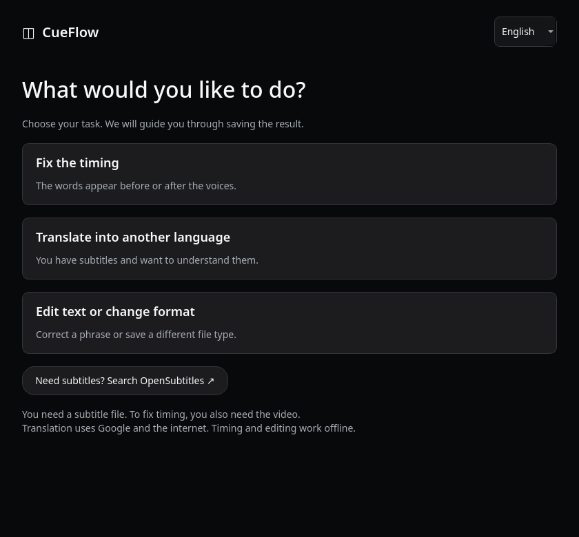
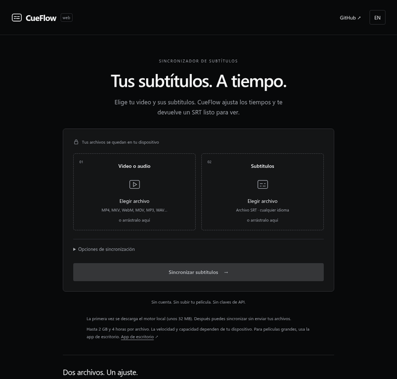

<p align="center"></p>

# CueFlow: Automatic Subtitle Sync / Sincronizador de subtítulos

[](https://github.com/clls1-stinger/CueFlow/releases/latest)
[](LICENSE)

**CueFlow is a free, open-source subtitle synchronizer for the web, Windows, macOS and Linux.**
Automatically sync an existing SRT with a video or audio file, fix subtitle delay and
frame-rate drift, and choose the audio track you want. The desktop app uses ffsubsync and FFmpeg; the web app uses FFmpeg WebAssembly, WebRTC VAD and timing correlation. Processing stays on your device, without uploads, transcription or API keys.

**CueFlow es un sincronizador de subtítulos gratuito y de código abierto para Windows,
macOS, Linux y el navegador.** Ajusta un SRT adelantado, atrasado o con desfase progresivo usando las
voces del video. Permite elegir la pista de audio y funciona sin conexión ni claves de API.

[Open web app / Abrir versión web](https://cueflow.enriquepl.com/) ·
[Download / Descargar](https://github.com/clls1-stinger/CueFlow/releases/latest) ·
[English](#english) · [Español](#español) · [Build from source](docs/BUILDING.md)



The GIF records the actual application using an original synthetic audio fixture.
El GIF muestra la aplicación real con un audio sintético de prueba creado para este proyecto.

## Use CueFlow online / Usa CueFlow en línea

**[cueflow.enriquepl.com](https://cueflow.enriquepl.com/)** — choose a video or audio file,
choose its SRT, then download the synchronized subtitles. No installation or account.
Audio-track selection and subtitle encodings work independently of the English/Spanish UI.

Elige el video o audio, elige su SRT y descarga los subtítulos sincronizados.
Sin instalar nada ni crear una cuenta. Puedes elegir la pista de audio y la codificación
del texto. La web enlaza a este repositorio y a las descargas de escritorio.

The browser downloads a local engine (about 32 MB) on first use. Files are processed
locally and are never uploaded. The web edition accepts files up to 2 GiB and 4 hours;
available memory and browser support can impose lower limits. Use desktop for larger files.
El navegador descarga el motor en el primer uso y procesa los archivos localmente.
Para películas grandes o dispositivos con poca memoria, usa la versión de escritorio.



Hosted on **Cloudflare Pages with a Workers-powered Pages Function** at `/api/health`.
See [web setup, deployment and limitations](docs/WEB.md).

## English

### Automatically sync SRT subtitles with video or audio

Give CueFlow a video and its SRT. It detects when people are speaking, compares those
intervals with the subtitle timings and finds a time shift and playback-speed correction.
This fixes subtitles that start too early or late, as well as timing drift caused by
common frame-rate differences.

The CueFlow desktop app is a graphical interface around [ffsubsync](https://github.com/smacke/ffsubsync),
the engine that performs the alignment. [FFmpeg](https://ffmpeg.org/) reads the audio,
and WebRTC VAD detects speech. CueFlow adds English and Spanish controls, drag and drop,
audio-track selection, encoding options, cancellation, input validation and safe output naming.

Audio and subtitle languages are independent of the English/Spanish interface.
CueFlow uses speech timing rather than the meaning of words, so the video and subtitles
can be in different languages: for example, Japanese audio with Spanish subtitles,
English audio with Arabic subtitles, or French audio with Chinese subtitles.
There is no language allowlist and no language-specific transcription model. It does not translate, generate subtitles, edit the video or
guarantee word-perfect alignment. Review a scene near the start, middle and end.

### Download and run

Open [Releases](https://github.com/clls1-stinger/CueFlow/releases/latest) and choose your platform.
Release automation publishes the downloads only after all four builds and their tests pass.

| Platform | File | How to open |
| --- | --- | --- |
| Windows 10/11, x64 | `CueFlow-1.1.0-windows-x64.zip` | Extract the whole ZIP; run `CueFlow.exe`. |
| macOS 12+, Apple Silicon | `CueFlow-1.1.0-macos-arm64.zip` | Extract and open `CueFlow.app`. |
| macOS 12+, Intel | `CueFlow-1.1.0-macos-x64.zip` | Extract and open `CueFlow.app`. |
| Linux x64, Ubuntu 22.04+ or compatible | `CueFlow-1.1.0-linux-x64.tar.gz` | Extract; run `./CueFlow/CueFlow`. |

The downloads include Python, the application libraries, FFmpeg and ffprobe. Keep the
extracted folder together. Linux still needs a graphical desktop and standard OpenGL,
font and X11/Wayland libraries; see [building and troubleshooting](docs/BUILDING.md).
NixOS users can run from source using the included `shell.nix`.

These initial builds are unsigned and macOS builds are not notarized. Your OS may ask
you to approve opening a downloaded app. On macOS, use Privacy & Security → Open Anyway
if you trust the downloaded release. Android, iOS, Windows ARM and Linux ARM binaries
are not included in this release. Source availability is not a promise of support for every OS.

### Use it

1. Choose or drop your video and `.srt` file.
2. Select the dialogue audio track; language tags and titles help identify dubbed tracks.
3. Choose where to save the result. The video folder is selected by default.
4. Click **Synchronize subtitles**.
5. Open the output folder and load the new SRT in your player.

The result is named `video.synced.srt`. If that name exists, CueFlow creates
`video.synced.1.srt`, then `.2.srt`, and so on. Neither input is overwritten.
If your player needs an exact filename match, select the subtitle manually or rename
the result after checking that you will not replace another file.

Advanced options let you choose a subtitle encoding, disable encoding repair, disable
speed correction or change the maximum shift (default: five minutes).
Encoding repair uses `ftfy.fix_encoding`; it does not paraphrase or translate dialogue.
All output is UTF-8. Unsupported or malformed input produces an error rather than a
partially parsed subtitle file.

### What to expect

- Best results: matching editions with a fixed delay or uniform timing drift.
- Choose the dialogue track you will listen to. Track languages come from file metadata, not speech recognition.
- Different dubs can change speech timing. Language-independent processing does not guarantee equal accuracy across all languages, dubs or edits.
- Music, sparse speech, unrelated subtitles or different movie cuts can produce poor alignment.
- Missing scenes and multiple discontinuities may need manual editing. This release applies one global transform.
- No confidence percentage is claimed. The reported shift and scale describe the applied correction.
- Processing time depends on duration, codec and hardware. No transcription service is used.

## Español

### Sincronizar subtítulos SRT con video o audio

Elige un video y su SRT. CueFlow detecta los intervalos en los que hay voces, los compara
con los tiempos del subtítulo y calcula un desplazamiento y una corrección de velocidad.
Así puede corregir subtítulos adelantados, atrasados o que se desajustan progresivamente
por diferencias de fotogramas por segundo.

El motor de sincronización es [ffsubsync](https://github.com/smacke/ffsubsync).
[FFmpeg](https://ffmpeg.org/) lee el audio y WebRTC VAD detecta las voces.
CueFlow añade una interfaz en español e inglés, arrastrar y soltar, opciones de
codificación, selección de pistas de audio, cancelación, validación de archivos y guardado
sin sobrescribir.

Los idiomas del audio y del SRT son independientes del español e inglés de la interfaz.
Compara los tiempos de las voces, no el significado de las palabras: puedes sincronizar
audio japonés con subtítulos en español, audio inglés con texto árabe o audio francés
con texto chino. No hay una lista de idiomas permitidos ni un modelo de transcripción
por idioma. No traduce, genera subtítulos ni modifica
el video. Tampoco garantiza precisión palabra por palabra: revisa una escena al inicio,
a la mitad y al final.

### Descargar y abrir

Entra en [Releases](https://github.com/clls1-stinger/CueFlow/releases/latest) y descarga
el archivo para tu equipo. La publicación automática espera a que las cuatro compilaciones
y sus pruebas terminen correctamente.

| Sistema | Archivo | Cómo abrirlo |
| --- | --- | --- |
| Windows 10/11, x64 | `CueFlow-1.1.0-windows-x64.zip` | Extrae todo el ZIP y ejecuta `CueFlow.exe`. |
| macOS 12+, Apple Silicon | `CueFlow-1.1.0-macos-arm64.zip` | Extrae y abre `CueFlow.app`. |
| macOS 12+, Intel | `CueFlow-1.1.0-macos-x64.zip` | Extrae y abre `CueFlow.app`. |
| Linux x64, Ubuntu 22.04+ o compatible | `CueFlow-1.1.0-linux-x64.tar.gz` | Extrae y ejecuta `./CueFlow/CueFlow`. |

Las descargas incluyen Python, las bibliotecas, FFmpeg y ffprobe. Conserva completa la
carpeta extraída. Linux requiere un escritorio gráfico y sus bibliotecas habituales;
consulta [compilación y solución de problemas](docs/BUILDING.md). En NixOS puedes usar
el código fuente con el archivo `shell.nix` incluido.

Las primeras compilaciones no tienen firma de editor y las de macOS no están notarizadas.
El sistema puede pedirte que autorices abrir la aplicación descargada. En macOS puedes
usar Privacidad y seguridad → Abrir igualmente si confías en la descarga. Esta versión
no incluye binarios para Android, iOS, Windows ARM ni Linux ARM.

### Cómo usarla

1. Selecciona o arrastra el video y el archivo `.srt`.
2. Elige la pista de diálogo; sus etiquetas de idioma y título ayudan a identificar cada doblaje.
3. Elige la carpeta de destino. Por defecto se usa la del video.
4. Pulsa **Sincronizar subtítulos**.
5. Abre la carpeta del resultado y carga el nuevo SRT en tu reproductor.

El resultado se llama `video.synced.srt`. Si ya existe, se guarda como
`video.synced.1.srt`, después `.2.srt`, etc. Los originales se conservan.
Si tu reproductor exige que los nombres coincidan exactamente, selecciona el subtítulo
manualmente o renómbralo después de comprobar que no reemplazará otro archivo.

En las opciones avanzadas puedes elegir la codificación, desactivar su reparación,
desactivar la corrección de velocidad o cambiar el desfase máximo, que por defecto es
de cinco minutos. La reparación usa `ftfy.fix_encoding` y no reescribe ni traduce los
diálogos. El resultado se guarda en UTF-8.

### Límites

- Funciona mejor con la misma edición del video y un desfase fijo o progresivo uniforme.
- Elige la pista de diálogo que vas a escuchar. Su idioma se lee de las etiquetas del archivo, no se reconoce por voz.
- Los doblajes pueden cambiar los tiempos del diálogo. No se garantiza la misma precisión con todos los idiomas, doblajes o ediciones.
- La música, pocas voces, subtítulos ajenos o cortes diferentes pueden empeorar el resultado.
- Las escenas eliminadas y varios saltos de tiempo pueden requerir edición manual.
- No muestra un porcentaje de precisión: el desfase y el factor indican la corrección aplicada.
- El tiempo depende de la duración, el códec y el equipo. No se usan servicios de transcripción.

## Subtitle synchronization FAQ / Preguntas frecuentes

### Can I sync subtitles in another language?

Yes. CueFlow aligns voice activity with subtitle timing, without understanding or
translating the words. Audio and SRT languages do not need to match. The selected audio
track must still correspond to the same scenes and edition as the subtitle file.

### Does CueFlow translate subtitles or generate a dub?

No. It changes SRT timestamps and can repair text encoding. It preserves dialogue and
does not modify the audio or video. English and Spanish are the interface languages.

### How do I fix subtitles that get further out of sync?

Keep **Correct playback-speed differences** enabled for uniform timing drift, such as
common 23.976/25 fps differences. A different movie cut or missing scenes may require
manual editing; a single global timing correction cannot repair every discontinuity.

### ¿Sirve para subtítulos en japonés, chino, árabe o ruso?

Sí. Admite texto Unicode y permite elegir codificaciones antiguas como CP932/Shift JIS,
GB18030, Big5, CP949 y Windows-1251/1256. Si la detección automática no acierta, selecciona
la codificación en Opciones avanzadas. El resultado se guarda en UTF-8 y conserva el idioma.

### ¿Puedo sincronizar un MKV con varios doblajes?

Sí. Selecciona el MKV y elige la pista de diálogo que escucharás. Si falta la etiqueta de
idioma, la aplicación muestra «Idioma no indicado»; no adivina el idioma. También acepta
archivos de audio compatibles, como WAV, MP3, FLAC y MKA.

### ¿Sube mis archivos a internet o cobra por minuto?

No. La sincronización funciona en tu equipo. No requiere cuentas, claves de API ni
servicios de transcripción. El tiempo de procesamiento depende del archivo y del hardware.

## Development / Desarrollo

```bash
uv sync --frozen --python 3.12 --extra dev
uv run python -m cueflow
```

Source runs need `ffmpeg` and `ffprobe` on `PATH` or a build in `vendor/ffmpeg`.
Para ejecutar el código fuente necesitas `ffmpeg` y `ffprobe` en el `PATH` o compilados
en `vendor/ffmpeg`.

Command-line example: `uv run cueflow movie.mkv subtitles.srt --audio-track 2 --encoding utf-8`.
`--audio-track` starts at 1 and refers to audio tracks, not all container streams.

See [BUILDING.md](docs/BUILDING.md) for tests, native packaging and release instructions.
Consulta [BUILDING.md](docs/BUILDING.md) para las pruebas, compilación y publicación.

## Credits and license / Créditos y licencia

CueFlow's code is MIT licensed. It builds on ffsubsync, FFmpeg, WebRTC VAD, PySide6,
NumPy, srt, ftfy and other open-source projects. They retain their own licenses.
See [THIRD_PARTY.md](THIRD_PARTY.md) and the bundled license notices.

El código de CueFlow usa la licencia MIT. Sus dependencias conservan sus propias
licencias. Consulta [THIRD_PARTY.md](THIRD_PARTY.md) y los avisos incluidos.

## Help and feedback / Ayuda

[Report a bug or request a feature](https://github.com/clls1-stinger/CueFlow/issues).
Include your OS, CueFlow version and technical error details. Keep private media and
credentials out of public reports. Maintained by [clls1-stinger](https://github.com/clls1-stinger).

[Reporta un problema o sugiere una función](https://github.com/clls1-stinger/CueFlow/issues).
Indica tu sistema, versión de CueFlow y detalles del error. Conserva tus archivos privados
y credenciales fuera de los reportes públicos.
